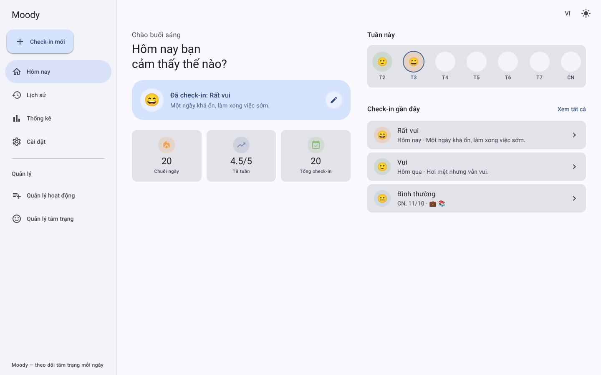
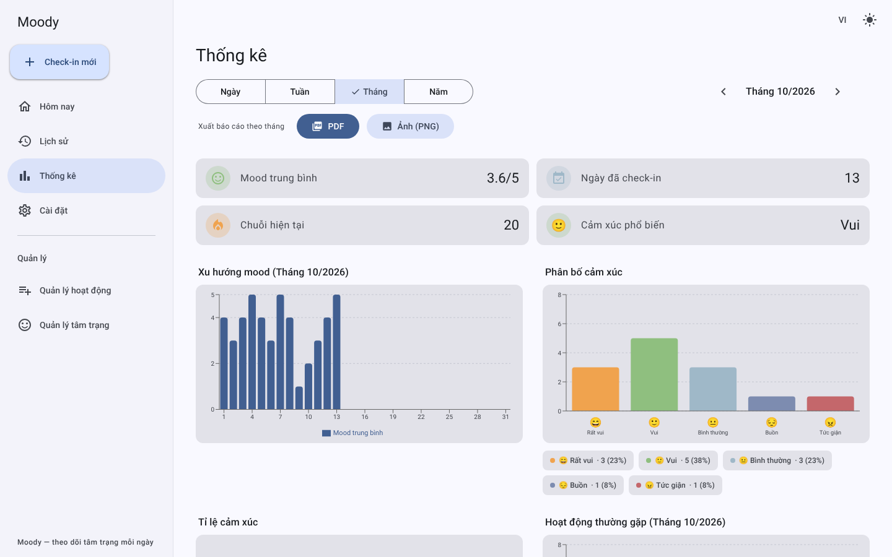
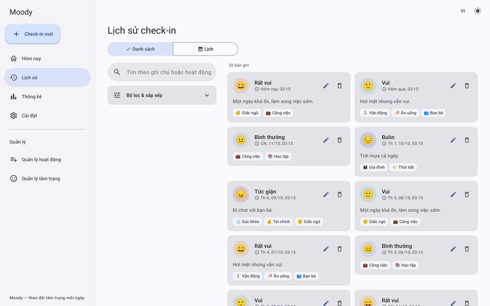
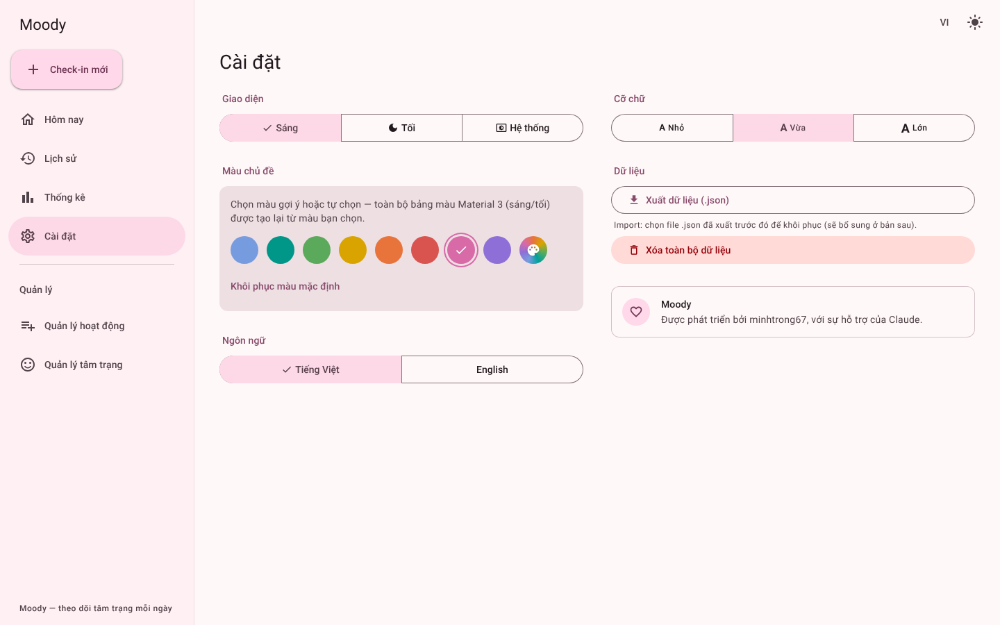
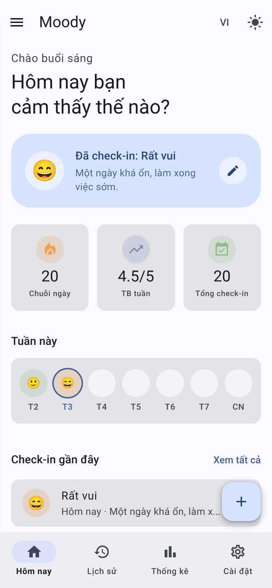
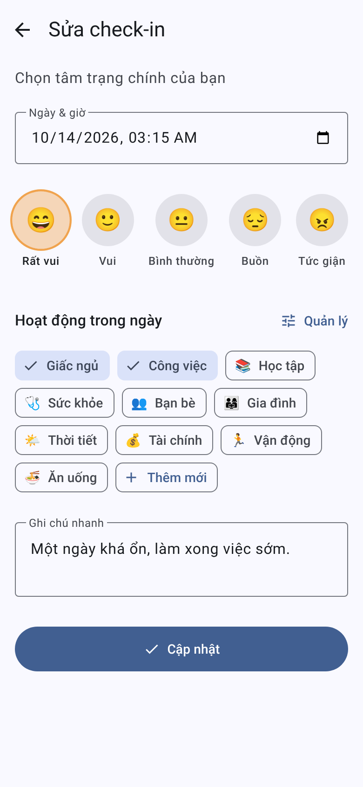
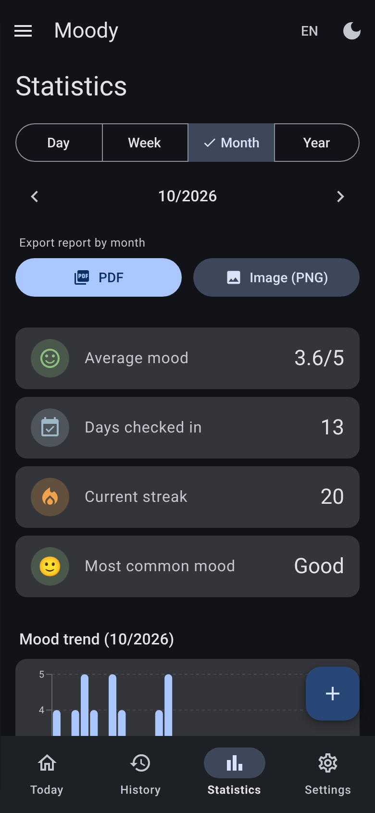
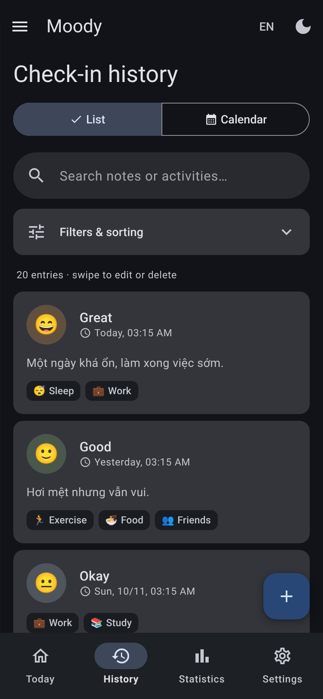

<div align="center">


# Moody

**Nhật ký tâm trạng hằng ngày — Daily mood journal**

Check-in mỗi ngày, nhìn lại xu hướng cảm xúc và xuất báo cáo. Thiết kế theo **Material Design 3**, hỗ trợ **Tiếng Việt / English**, dùng được như một **PWA** trên cả điện thoại lẫn máy tính.


</div>

---

## Mục lục

- [Giới thiệu](#giới-thiệu)
- [Ảnh chụp màn hình](#ảnh-chụp-màn-hình)
- [Tính năng](#tính-năng)
- [Cài đặt](#cài-đặt)
- [Tech stack](#tech-stack)
- [Development](#development)
- [Build & triển khai](#build--triển-khai)
- [Cấu trúc project](#cấu-trúc-project)
- [License](#license)

## Giới thiệu

Moody giúp bạn ghi lại tâm trạng chỉ trong vài giây: chọn một trong 5 mức cảm xúc, gắn hoạt động trong ngày và thêm ghi chú. Sau đó xem lại bằng danh sách, lịch tháng và các biểu đồ thống kê, hoặc xuất thành báo cáo PDF/PNG.

- **Dùng ngay không cần tài khoản** — chế độ khách lưu dữ liệu trong `localStorage`; đăng nhập Google để đồng bộ lên Firestore.
- **Mobile-first, nhưng không chỉ cho mobile** — điện thoại dùng thanh điều hướng dưới; laptop/PC dùng menu cố định bên trái và bố cục nhiều cột.
- **Cá nhân hóa** — đổi màu chủ đề (toàn bộ bảng màu Material 3 được sinh lại từ màu bạn chọn), sáng/tối, cỡ chữ và ngôn ngữ.

## Ảnh chụp màn hình

| Máy tính — Hôm nay | Máy tính — Thống kê |
|---|---|
|  |  |

| Máy tính — Lịch sử | Máy tính — Cài đặt (đổi màu chủ đề) |
|---|---|
|  |  |

| Điện thoại — Hôm nay | Điện thoại — Check-in | Điện thoại — Thống kê (tối, EN) | Điện thoại — Lịch sử (tối, EN) |
|---|---|---|---|
|  |  |  |  |

## Tính năng

| Khu vực | Mô tả |
|---|---|
| **Hôm nay** | Lời chào, trạng thái check-in, dải 7 ngày, chuỗi ngày liên tiếp, mood trung bình tuần và các check-in gần đây |
| **Check-in** | Chọn ngày giờ, 1 trong 5 mức tâm trạng, nhiều hoạt động (chip), ghi chú tự giãn dòng; sửa lại bất kỳ lúc nào |
| **Lịch sử** | Dạng *Danh sách* (tìm kiếm, lọc thời gian/cảm xúc, sắp xếp, vuốt phải để sửa / vuốt trái để xóa) và dạng *Lịch tháng* (chạm ngày trống để tạo check-in) |
| **Thống kê** | Theo Ngày / Tuần / Tháng / Năm: xu hướng mood, phân bố & tỉ lệ cảm xúc (cột + tròn), hoạt động thường gặp |
| **Xuất báo cáo** | PDF hoặc ảnh PNG gồm chỉ số tổng quan, xu hướng, phân bố cảm xúc, **biểu đồ tròn tỉ lệ cảm xúc** và **biểu đồ phân bổ hoạt động** |
| **Quản lý hoạt động** | Thêm / sửa / xóa, kéo-thả hoặc dùng mũi tên để sắp xếp |
| **Quản lý tâm trạng** | Đổi emoji và tên hiển thị của 5 mức tâm trạng, khôi phục mặc định |
| **Cài đặt** | Giao diện sáng/tối/hệ thống, **màu chủ đề**, cỡ chữ, **ngôn ngữ (VI/EN)**, cài đặt PWA, xuất/xóa dữ liệu |

Điểm nhấn kỹ thuật:

- **Material Design 3** đầy đủ: color roles, shape, elevation, state layer, top app bar, navigation bar/drawer, FAB, dialog, snackbar, segmented button, switch, chip, outlined text field.
- **Màu chủ đề tùy chỉnh**: chọn màu gợi ý hoặc bất kỳ màu nào; bảng màu sáng/tối được sinh bằng [`@material/material-color-utilities`](https://github.com/material-foundation/material-color-utilities) và áp dụng trước khi vẽ trang (không bị nháy màu). Màu mặc định là xanh dương (seed `#769CDF`).
- **Responsive**: điện thoại → tablet → laptop → màn hình lớn.
- **Hiệu năng**: code-splitting theo trang, tách chunk `react` / `firebase` / `charts`, thư viện PDF chỉ nạp khi xuất báo cáo, skeleton loading đúng hình dạng nội dung.
- **SEO & chia sẻ**: meta description, canonical, Open Graph, Twitter Card, JSON-LD, `robots.txt`, ảnh xem trước 1200×630.
- **PWA**: cài đặt như app, hoạt động offline với service worker.

## Cài đặt

Yêu cầu: **Node.js ≥ 18** và npm.

```bash
git clone <repo-url> moody
cd moody
npm install
cp .env.example .env     # rồi điền thông tin Firebase (xem bên dưới)
npm run dev
```

Mở `http://localhost:5173`. **Không cấu hình Firebase vẫn chạy được** — ứng dụng dùng chế độ khách (dữ liệu lưu cục bộ).

### Cấu hình Firebase (tùy chọn)

1. Tạo project tại [Firebase Console](https://console.firebase.google.com).
2. **Authentication → Sign-in method** → bật **Google**.
3. **Firestore Database** → tạo database.
4. **Project settings → Your apps** → tạo Web app và copy từng giá trị vào `.env`:

   | Biến | Ý nghĩa |
   |---|---|
   | `VITE_FIREBASE_API_KEY` | API key của Web app |
   | `VITE_FIREBASE_AUTH_DOMAIN` | `your-project.firebaseapp.com` |
   | `VITE_FIREBASE_PROJECT_ID` | ID project |
   | `VITE_FIREBASE_STORAGE_BUCKET` | `your-project.appspot.com` |
   | `VITE_FIREBASE_MESSAGING_SENDER_ID` | Sender ID |
   | `VITE_FIREBASE_APP_ID` | App ID |
   | `VITE_SITE_URL` | URL triển khai (không có `/` cuối) — dùng cho canonical / Open Graph / Twitter Card |

5. Đặt **Firestore Security Rules** để mỗi người chỉ đọc/ghi dữ liệu của mình:

   ```
   rules_version = '2';
   service cloud.firestore {
     match /databases/{database}/documents {
       match /users/{userId}/{document=**} {
         allow read, write: if request.auth != null && request.auth.uid == userId;
       }
     }
   }
   ```

`.env` đã nằm trong `.gitignore`.

## Tech stack

| Mảng | Công nghệ |
|---|---|
| UI | React 18, React Router 6 (`HashRouter`) |
| Build | Vite 5, `vite-plugin-pwa` (Workbox) |
| Styling | Tailwind CSS 3 + CSS variables theo Material Design 3 |
| Màu động | `@material/material-color-utilities` |
| Icon & font | `react-icons` (Material Design icons), Roboto (`@fontsource/roboto`, tự host, có subset tiếng Việt) |
| Backend | Firebase Authentication (Google) + Cloud Firestore |
| Biểu đồ | Recharts |
| Báo cáo | html2canvas + jsPDF (nạp khi cần) |
| i18n | Bộ dịch nhẹ tự viết (`src/i18n`) — Tiếng Việt & English |

## Development

| Lệnh | Mô tả |
|---|---|
| `npm run dev` | Chạy dev server (HMR) |
| `npm run build` | Build production vào `dist/` |
| `npm run preview` | Chạy thử bản build |

Một số điểm cần biết khi phát triển:

- **Đổi màu mặc định**: sửa các biến `--md-*` (sáng + tối) trong [`src/index.css`](src/index.css) — có thể xuất bộ mới từ [Material Theme Builder](https://material-foundation.github.io/material-theme-builder/) — cùng `DEFAULT_SEED` trong [`src/lib/theme.js`](src/lib/theme.js), `theme_color` trong `vite.config.js` và icon trong `public/`.
- **Thêm ngôn ngữ / chuỗi mới**: thêm khóa vào `src/i18n/vi.js` và `src/i18n/en.js`, dùng `const { t } = useI18n()` → `t('khoa')`. Khóa thiếu sẽ rơi về tiếng Việt.
- **Biểu đồ** dùng màu literal đọc từ CSS variable hiện hành (`readRole()` trong `theme.js`) vì SVG của một số trình duyệt không resolve `var()` ổn định.
- **Ngày "hôm nay"** luôn tính theo giờ địa phương của thiết bị (không dùng `toISOString()` theo UTC).

## Build & triển khai

```bash
npm run build
```

Deploy thư mục `dist/` lên bất kỳ static host nào (Firebase Hosting, Vercel, Netlify, Cloudflare Pages…). Vì dùng `HashRouter` nên không cần cấu hình rewrite cho SPA. Nhớ đặt `VITE_SITE_URL` trước khi build để thẻ canonical / Open Graph trỏ đúng domain.

## Cấu trúc project

```
├── index.html                  # Meta SEO / Open Graph / Twitter / JSON-LD, màn hình khởi động
├── vite.config.js              # Vite + PWA manifest + tách chunk
├── tailwind.config.js          # Ánh xạ color roles Material 3, shape, elevation
├── public/                     # favicon, icon PWA, og-image, robots.txt
├── screenshots/                # Ảnh dùng trong README (image01 … image08)
└── src/
    ├── App.jsx · main.jsx
    ├── index.css               # Color roles (--md-*), typography, state layer, component class
    ├── i18n/                   # vi.js · en.js · index.jsx (I18nProvider, useI18n)
    ├── context/                # Auth, MoodEntries, Activities, Moods, Toast
    ├── hooks/                  # useMoodEntries, useActivities, useMoods, useInstallPrompt, useIsDark
    ├── lib/                    # moodConfig, dateUtils, statsUtils, reportGenerator, theme
    ├── components/             # AppShell, Sidebar, Dialog, ConfirmDialog, TextField, Switch,
    │                           # SegmentedButton, SwipeableRow, PageSkeleton, icons, Login…
    └── pages/                  # Dashboard, CheckIn, History, Statistics, Settings,
                                # ManageActivities, ManageMoods
```

**Mô hình dữ liệu** — `users/{uid}/entries/{id}`: `date` (`YYYY-MM-DD`), `time` (ISO), `mood` (`great|good|okay|sad|angry`), `score` (1–5), `activities[]`, `note`. Hoạt động và tên/emoji tâm trạng tùy chỉnh nằm ở `users/{uid}/meta/activities` và `users/{uid}/meta/moods`; ở chế độ khách mọi thứ lưu trong `localStorage`.

## License

Dự án **private** — bảo lưu mọi quyền © 2026 minhtrong67. Không sao chép, phân phối hoặc sử dụng lại khi chưa có sự cho phép bằng văn bản. (Nếu muốn mở mã nguồn, thêm file `LICENSE` — ví dụ MIT — và đổi badge ở đầu README.)
